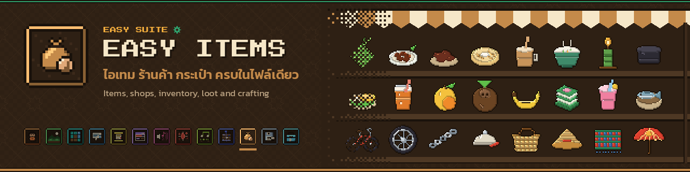
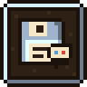
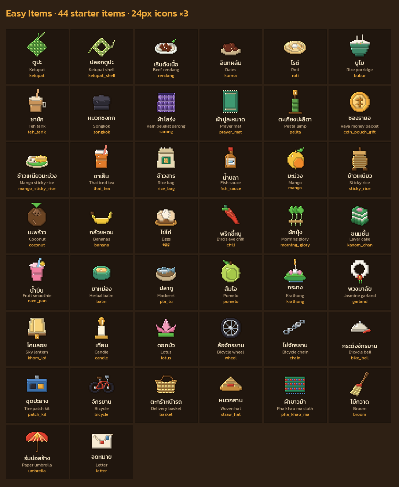
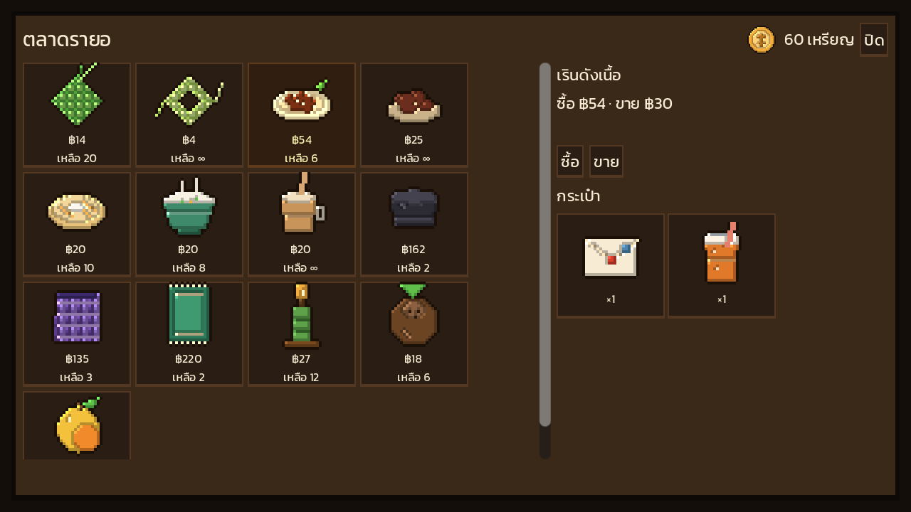
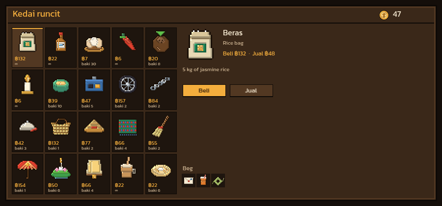
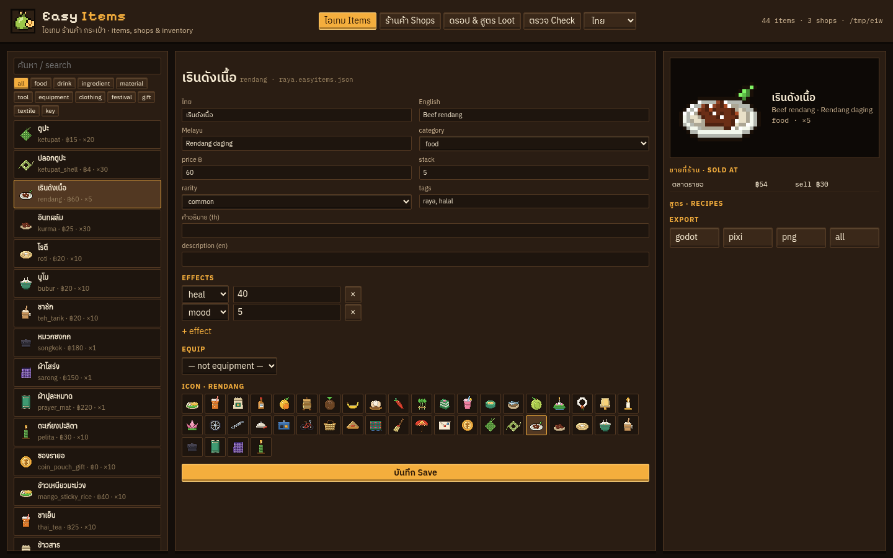

<!-- easy-suite:header:start -->
<p align="center">
  <a href="#easy-suite"></a>
</p>

<p align="center">
  <b>Easy Items</b> · ไอเทม ร้านค้า กระเป๋า ครบในไฟล์เดียว · Items, shops, inventory, loot and crafting<br />
  <sub>Part of <a href="#easy-suite"><b>Easy Suite</b></a>: Thai-friendly pixel-art game dev tools for Godot 4.3+ and PixiJS v8</sub>
</p>

<p align="center">
  <a href="https://github.com/Saladin2020/easyitems/actions/workflows/ci.yml"></a> <a href="LICENSE"></a>  <a href="#export"></a> <a href="docs/MCP.md"></a> 
</p>

<p align="center">
  <a href="https://github.com/Saladin2020/easysprite"></a>
  <a href="https://github.com/Saladin2020/easyscene"></a>
  <a href="https://github.com/Saladin2020/easytilemap"></a>
  <a href="https://github.com/Saladin2020/easydialogue"></a>
  <a href="https://github.com/Saladin2020/easyquest"></a>
  <a href="https://github.com/Saladin2020/easyui"></a>
  <a href="https://github.com/Saladin2020/easysfx"></a>
  <a href="https://github.com/Saladin2020/easyfx"></a>
  <a href="https://github.com/Saladin2020/easymusic"></a>
  <a href="https://github.com/Saladin2020/easyanim"></a>
  <a href="https://github.com/Saladin2020/easyitems"></a>
  <a href="https://github.com/Saladin2020/easysave"></a>
  <a href="https://github.com/Saladin2020/easykit"></a>
  <a href="https://github.com/Saladin2020/easybattle"></a>
  <a href="https://github.com/Saladin2020/easyfont"></a>
  <a href="https://github.com/Saladin2020/easynpc"></a>
  <a href="https://github.com/Saladin2020/easyportrait"></a>
  <a href="https://github.com/Saladin2020/easyship"></a>
</p>
<!-- easy-suite:header:end -->

# Easy Items

**ไอเทม ร้านค้า กระเป๋า ของดรอป และสูตรคราฟต์ สำหรับเกม 2D · ตลาดเช้า ร้านโชห่วย ตลาดรายอ**  
Describe a game's items, shops, loot tables and crafting recipes in a small JSON format (`easyitems/1`). Every item
has Thai / English / Malay names and a 24 or 32 px pixel icon drawn from code. Easy Items validates the whole
database (including the item ids your Easy Quest quests give and take), simulates buying, selling, equipping,
crafting and loot with one deterministic rule set, and exports a **Godot 4.3+** project (Resources, an `Items`
autoload, a shop UI scene) or a **PixiJS v8** runtime. CLI, web editor and MCP server; local only, no network.

<p align="center"></p>

| Godot shop UI (`shop_ui.tscn`, Thai, Raya bazaar) | PixiJS shop panel (Malay, general store) |
|---|---|
|  |  |

## Starter catalog

44 items in two documents that merge into one database, so the Thai village and its Muslim neighbours share one
economy. Everything is halal-appropriate: no pork, no alcohol.

| Document | Items | Shop |
|---|---|---|
| `village.easyitems.json` | food and drink (mango sticky rice, Thai iced tea, sticky rice, kanom chan, smoothie, pomelo…), ingredients (rice bag, fish sauce, coconut, eggs, chili, morning glory, mackerel), festival and gifts (krathong, sky lantern, jasmine garland, lotus, candle), bicycle parts (wheel, chain, bell, patch kit) and gear (bicycle, delivery basket, woven hat, pha khao ma, broom, paper umbrella), the quest letter | **ตลาดเช้า** morning market · **ร้านโชห่วย** general store (bicycle parts 5% off; also sells teh tarik and roti) |
| `raya.easyitems.json` | ketupat and shells, beef rendang, dates, roti canai, bubur, teh tarik, songkok, sarong, plain prayer mat (not sellable), pelita lamp, Raya money packet | **ตลาดรายอ** Raya bazaar: `halal: true` (checked), Raya items 10% off |

Loot tables: `delivery_tip`, `market_basket`, `scrap_pile`, `raya_visit`. Recipes: bicycle (2 wheels + chain + bell),
mango sticky rice, krathong, ketupat, pelita set. Item ids match the Easy Quest samples (`village_delivery`,
`ramadan_raya`): `check` reports 11 of 11 quest item ids found.

Content rules (enforced by `check` where they can be): halal shops may not stock pork, alcohol or `halal: false`
items; no Quran, Arabic calligraphy, sacred figures or depictions of the Prophet as items or icons.

## Quick start

```bash
npm ci && npm run build
npx easyitems init                      # items/ quests/ exports/ with the starter catalog
npx easyitems list --tag raya
npx easyitems shops raya_bazaar         # stock with buy / sell prices
npx easyitems check                     # database + Easy Quest cross-check, exit 1 on errors
npx easyitems loot market_basket --seed 42 --times 3
npx easyitems render --out icons.png --scale 3
npx easyitems export --preset all       # exports/easyitems-{godot,pixi,png,json}
npx easyitems serve                     # editor at http://127.0.0.1:8878
```

`add-item <id> --th --en --icon [--ms --category --price --stack --tag]` writes `items/game.easyitems.json`.
`icons` lists the 44 built-in icons. Set `EASYITEMS_WORKSPACE` or pass `--workspace`.

## The format

```json
{
  "format": "easyitems/1",
  "items": [
    { "id": "ketupat", "name": { "th": "ตูปะ", "en": "Ketupat", "ms": "Ketupat" }, "category": "food",
      "price": 15, "stack": 20, "icon": "ketupat", "effects": [{ "kind": "heal", "amount": 20 }], "tags": ["raya", "halal"] }
  ],
  "shops": [
    { "id": "raya_bazaar", "name": { "th": "ตลาดรายอ", "en": "Raya bazaar" }, "keeper": "kakna", "halal": true,
      "buyMod": 1, "sellMod": 0.5, "tagMods": { "raya": 0.9 }, "stock": [{ "item": "ketupat", "qty": 20, "restock": 1 }] }
  ],
  "loot": [{ "id": "raya_visit", "rolls": [1, 2], "entries": [{ "item": "kurma", "weight": 3 }], "guaranteed": [{ "item": "coin_pouch_gift", "n": 1 }] }],
  "recipes": [{ "id": "ketupat", "name": { "th": "สานตูปะ", "en": "Weave ketupat" }, "inputs": [{ "item": "ketupat_shell", "n": 1 }, { "item": "rice_bag", "n": 1 }], "outputs": [{ "item": "ketupat", "n": 4 }] }]
}
```

Prices: buy = `stock.price` or `round(price × buyMod × tagMods)`; sell = `floor(price × sellMod)`, only for categories
in `buys`. Full reference: [docs/FORMAT.md](docs/FORMAT.md).

## Life skills

Farming, fishing and cooking level up with XP (`easyitems skills`). The `life` sample adds seeds, a fishing rod,
tilapia, ปลาเผา and ผัดผักบุ้ง (halal), two crops, two fishing spots and level-gated cooking recipes. Weather and
seasons come from [Easy NPC](../easynpc): rain waters the plots, storms cut the bite chance.

## Export

| Preset | What you get |
|---|---|
| `godot` | A Godot 4.3+ project: `easyitems/items/<id>.tres` (`EasyItem` with an `AtlasTexture` icon), `shops/<id>.tres` (`EasyShop`), `easyitems.gd` autoload `Items` (inventory, equipment, buy / sell / restock, craft, loot, signals), `shop_ui.tscn` (uses Easy UI's `res://easyui/themes/teak.tres` when present, otherwise the bundled teak theme with Kanit), `main.tscn` demo, `test_items.gd` |
| `pixi` | `easyitems.json` (db + atlas), `icons.png` + `icons.atlas.json` spritesheet, `easyitems-core.js` (rules, no dependencies, also runs in Node), `easyitems-pixi.js` (`loadItems(PIXI, url)` → `inventory`, `icon(id)`, `shopPanel(shopId, {lang})`), `index.html` demo, Kanit |
| `png` | `icons.png` atlas, `icons/<id>.png`, optional `icons@Nx/` |
| `json` | merged `easyitems.db.json` |

The TypeScript engine, the Pixi runtime and the Godot autoload follow the same rules and the same seeded
mulberry32 loot rolls. Tests replay a 27-step script (buy, sell, out of stock, not enough coins, equip, craft,
loot, restock) in all three and compare canonical JSON states.

```gdscript
Items.buy("raya_bazaar", "ketupat")         # {ok, coins} or {ok: false, reason: "not_enough_coins"}
Items.use("ketupat")                         # applies effects, returns them
var drops = Items.loot("raya_visit", 7)      # same drops as the CLI with --seed 7
$ShopUI.open("market")
```

## Web editor

`easyitems serve` (port 8878; `npm run dev` uses Vite on 5185). Tabs: **Items** (form, icon picker, where it is
sold, recipes, export), **Shops** (play the shop with the real rules: buy, sell, next day restock), **Loot & recipes**
(12 seeds side by side) and **Check** (validation and quest cross-reference). Thai / English / Malay switch.



## MCP server

`npm run mcp` (stdio) or `npm run mcp:http` (port 8879). Tools: `workspace_info`, `list_items`, `get_item`,
`write_items` (validates against the whole workspace, `dryRun`), `check_items`, `render_icons` (returns the PNG),
`roll_loot`, `simulate`, `export_items`. See [docs/MCP.md](docs/MCP.md).

## Ports

| | Port |
|---|---|
| Editor + API (`serve`) | 8878 |
| MCP over HTTP | 8879 |
| Vite dev server | 5185 |

Writes from the browser need same-origin requests plus a per-run token; the server only answers to loopback
hosts. Workspace paths outside the workspace or `EASYITEMS_ALLOWED_DIRS` are refused.

## Development

```bash
npm test                  # vitest
GODOT=/path/to/godot npx vitest run test/godot.test.ts   # headless Godot check
npm run typecheck
npm run smoke             # CLI + MCP (stdio and HTTP)
npm run check:pixi -- exports/easyitems-pixi shot.png     # headless Chrome clicks buy / sell in the Pixi demo
node scripts/render-docs.mjs                              # contact sheets
```

<!-- easy-suite:table:start -->
## Easy Suite


Eighteen small, local-first tools that share one look (teak, lantern gold, Kanit, 16/48px pixels), one
workflow (CLI · web editor · MCP server) and the same targets (**Godot 4.3+** and **PixiJS v8**).
ชุดเครื่องมือทำเกมพิกเซลสไตล์ไทย ใช้ร่วมกันได้ทั้งชุด · **Easy Kit** builds a whole playable game from the others and
**Easy Ship** packages it for the web, desktop and Android.  
The samples share one multicultural southern Thai village: Buddhist temple, wooden kampung mosque and
Chinese-Thai shrine on the same street. หมู่บ้านพหุวัฒนธรรม วัด มัสยิด ศาลเจ้า อยู่ร่วมกันในเมืองเดียว

| | Tool | What it does | Repo |
|:-:|---|---|---|
|  | [**Easy Sprite**](https://github.com/Saladin2020/easysprite) | Compose modular 48px chibi characters (top-down + side-view) and export sheets. | [`easysprite`](https://github.com/Saladin2020/easysprite) |
|  | [**Easy Scene**](https://github.com/Saladin2020/easyscene) | Side-view levels: parallax layers, 16px autotiles, Thai town props. | [`easyscene`](https://github.com/Saladin2020/easyscene) |
|  | [**Easy Tilemap**](https://github.com/Saladin2020/easytilemap) | Top-down 16px maps: blob-47 autotiles, objects, collision, spawns. | [`easytilemap`](https://github.com/Saladin2020/easytilemap) |
|  | [**Easy Dialogue**](https://github.com/Saladin2020/easydialogue) | Branching `.ezd` dialogue with Thai-safe text, portraits and choices. | [`easydialogue`](https://github.com/Saladin2020/easydialogue) |
|  | [**Easy Quest**](https://github.com/Saladin2020/easyquest) | Text `.ezq` quests: steps, flags, items, rewards, linked to dialogue. | [`easyquest`](https://github.com/Saladin2020/easyquest) |
|  | [**Easy UI**](https://github.com/Saladin2020/easyui) | Nine-slice pixel UI kit: panels, bars, inventory, menus, 30 icons. | [`easyui`](https://github.com/Saladin2020/easyui) |
|  | [**Easy SFX**](https://github.com/Saladin2020/easysfx) | Deterministic 8-bit SFX and 4-channel chiptune loops, typing blips. | [`easysfx`](https://github.com/Saladin2020/easysfx) |
|  | [**Easy FX**](https://github.com/Saladin2020/easyfx) | Pixel particles: sparks, fire, rain, lanterns, Raya pelita; sheets + Godot particles. | [`easyfx`](https://github.com/Saladin2020/easyfx) |
|  | [**Easy Music**](https://github.com/Saladin2020/easymusic) | Seeded Thai loop music: ranat, khong wong, saw, khim, pi, kompang; seamless WAV/OGG loops. | [`easymusic`](https://github.com/Saladin2020/easymusic) |
|  | [**Easy Anim**](https://github.com/Saladin2020/easyanim) | Cutscene timelines: actors, camera, dialogue, FX and music cues; Godot + Pixi runners. | [`easyanim`](https://github.com/Saladin2020/easyanim) |
|  | **Easy Items** ← you are here | Item database, shops, inventory, loot tables and crafting; 44 starter items with pixel icons. | [`easyitems`](https://github.com/Saladin2020/easyitems) |
|  | [**Easy Save**](https://github.com/Saladin2020/easysave) | Versioned save slots with migrations and checksums; Thai / English / Malay string tables. | [`easysave`](https://github.com/Saladin2020/easysave) |
|  | [**Easy Kit**](https://github.com/Saladin2020/easykit) | One command drives the Easy tools into a playable Godot 4.3+ and PixiJS game (portraits, schedules, battles, Thai pixel font) and ships it with Easy Ship; unified MCP server and `doctor`. | [`easykit`](https://github.com/Saladin2020/easykit) |
|  | [**Easy Battle**](https://github.com/Saladin2020/easybattle) | Turn-based battles: party, bestiary, skills, statuses, bosses; seeded simulator; Godot + Pixi runtimes. | [`easybattle`](https://github.com/Saladin2020/easybattle) |
|  | [**Easy Font**](https://github.com/Saladin2020/easyfont) | Pixel bitmap fonts for Thai, Latin and Malay: stacking vowels and tones, BMFont / TTF for Godot + Pixi. | [`easyfont`](https://github.com/Saladin2020/easyfont) |
|  | [**Easy NPC**](https://github.com/Saladin2020/easynpc) | NPC daily schedules with A* on Easy Tilemap maps, day / night, affinity, dialogue and quest hooks. | [`easynpc`](https://github.com/Saladin2020/easynpc) |
|  | [**Easy Portrait**](https://github.com/Saladin2020/easyportrait) | 64×64 dialogue portraits with 9 emotions, blink and talk frames, from Easy Sprite characters. | [`easyportrait`](https://github.com/Saladin2020/easyportrait) |
|  | [**Easy Ship**](https://github.com/Saladin2020/easyship) | Toolchain doctor, web / Windows / Linux / Android builds, itch.io zips and butler plans; dry run by default. | [`easyship`](https://github.com/Saladin2020/easyship) |

### Works with

- **Easy Quest**: `check` reads `.ezq` files and reports item ids that quests `give`, `take` or test with `has()` / `count()` but the database lacks (with a suggestion).
- **Easy UI**: icons follow its 24px icon style; the Godot shop UI picks up its teak theme when installed.
- **Easy Dialogue** cast ids work as shop `keeper`s; **Easy SFX** coin and **Easy FX** coin-burst pair with `Items.coins_changed`.
- **Easy Save**: the Godot autoload's `to_dict()` / `from_dict()` state is what a save slot stores, and item names extract into its string tables.
<!-- easy-suite:table:end -->

## Credits

Icons and sample data are drawn and written in code and dedicated to the public domain (CC0 1.0). Kanit is
bundled under the SIL OFL 1.1. See [CREDITS.md](CREDITS.md). Code: MIT.
